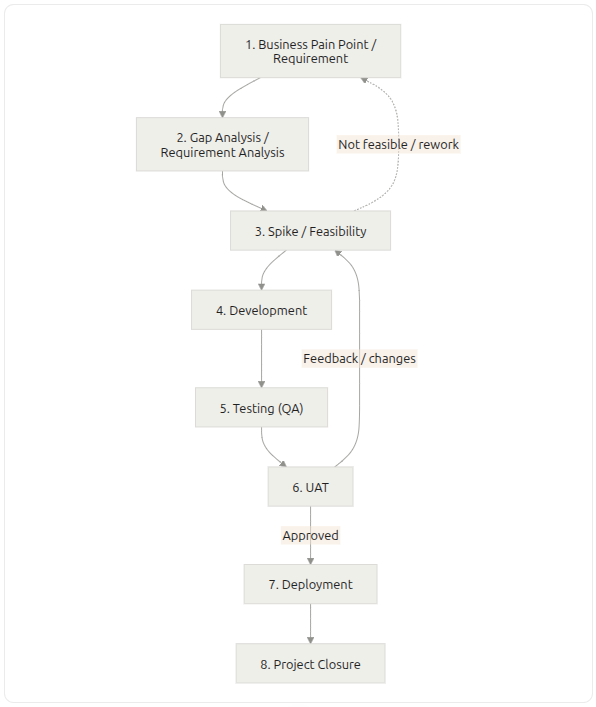

# Project Delivery Templates — Workflow Guide

Reusable templates for any software project that follows this delivery workflow. Copy the set into a new project folder, replace every `[placeholder]`, and delete the guidance notes (lines starting with **Guidance:**) before sharing.

## The workflow

| Step | Name | Template | Moves on when |
| --- | --- | --- | --- |
| 1 | Business pain point / requirement | `01-BRD-Template` | BRD approved by the product owner |
| 2 | Gap analysis / requirement analysis | `02-Gap-Analysis-Template` | Every requirement has a feasibility rating and an action |
| 3 | Spike / feasibility | `03-Spike-Feasibility-Template` | Go / no-go rules say **Go** |
| 3 → 1 | Not feasible / rework | `03a-Rework-Plan-Template` | BRD updated, spike re-run, or project stopped |
| 4 | Development | `04-Development-Plan-Template` | Handoff checklist to QA complete |
| 5 | Testing (QA) | `05-Test-Plan-QA-Template` | QA exit criteria met |
| 6 | UAT | `06-UAT-Plan-Template` | Users accept the release candidate |
| 6 → 3 | Feedback / changes | `06a-Feedback-Change-Management-Template` | Each change request routed, done and verified |
| 6 → 7 | Approved | `06b-Release-Approval-Template` | Approval record signed |
| 7 | Deployment | `07-Deployment-Plan-Template` | Deployment record signed |
| 8 | Project closure | `08-Project-Closure-Template` | Closure record signed |

## Loops in the workflow

- **Not feasible / rework (3 → 1):** the spike shows an approach cannot meet a requirement. Change the BRD (scope, priority, target) and run the spike again, or stop the project.
- **Feedback / changes (6 → 3):** UAT finds something that needs a new technical approach. Raise a change request; it goes back to the spike for that component only, then through development, QA and a UAT re-check.

## How to use the templates

1. **One document per step.** Keep the step number in the file name so the set stays in order.
2. **Requirement IDs everywhere.** Number requirements in the BRD (`BR-01`, `NFR-01`) and use those IDs in every later document, so each test, change and decision traces back to a requirement.
3. **Version every document.** Each template ends with a change log. Minor updates add 0.1 (1.0 → 1.1); a scope change adds 1.0.
4. **Update in flow order.** When something changes, update the BRD first, then each later document it affects.
5. **Delete what does not apply.** A small project can merge steps 2 and 3, or skip the early-access stage in deployment. Note any skipped section with one line saying why.

## Document control (use at the top of every template)

| Field | Entry |
| --- | --- |
| Project | [Project name] |
| Document | [Document name] |
| Version | [1.0] |
| Date | [YYYY-MM-DD] |
| Author | [Name] |
| Approver | [Name, role] |
| Status | Draft / In review / Approved |

## Placeholder conventions

| Placeholder | Meaning |
| --- | --- |
| `[Project name]` | Replace with your text |
| `[BR-xx]` | A requirement ID from the BRD |
| `[YYYY-MM-DD]` | A date |
| `[n]` | A number or target value |
| **Guidance:** | Instruction for the author; delete before sharing |
